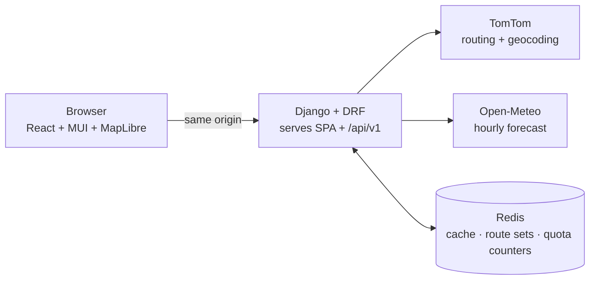

# Weather-Aware Truck Routing — Implementation Plan

Source brief: `fs-assessment-spotter.pdf` (Full Stack Developer assessment, React + Django).
Revision 2, 2026-10-24. This version folds in an external review and lines the plan up with the job description (React + **MUI**, DRF, Redis, Docker, GCP). Appendix A lists every review point and what was done with it.

---

## 1. What we're building

The driver enters an origin, a destination, a departure time and a load weight. The app returns **three truck routes**. Each route is scored for weather risk at **checkpoints every 10, 25 or 50 miles**, using the weather forecast for the truck's **ETA at each checkpoint**. The app recommends one route and shows everything on a map. A **weather heatmap over the trip corridor** comes with a **0–48 h forecast slider**.

**Where the marks are**

| Weight | Area | What it means for the plan |
|---|---|---|
| 40% | Routes, weather, risk and recommendation logic | Built first as pure, fully tested functions. Missing data can never make a route look safer. |
| 40% | UI, map and heatmap smoothness and performance | MUI interface that's been polished with care. WebGL map. The slider changes paint properties only. Routes load before the heavier data. |
| 15% | Code quality | Clear layers, strict types, linting, CI, Docker |
| 5% | Docs and Loom | README covering decisions, quotas and AI usage. The walkthrough opens on the live demo. |

> "Prioritize correctness and clarity over extra features." Anything in §13 starts only after the hosted app works end to end.

---

## 2. Spec interpretations (decide once, record in the README)

| Topic | Brief says | Decision |
|---|---|---|
| Sampling interval | "every 10 / 25 / 50 miles" | The user picks 10, 25 or 50 (default 25). |
| Checkpoint set | — | The **origin (mile 0) and destination are always checkpoints**. Interval checkpoints sit at N, 2N, … If one falls within 1 mile of the destination, it is dropped and the destination takes its place. |
| Threshold edges | Ranges overlap or leave gaps (rain 0.10–0.25 and 0.25–0.50; wind 34 vs 35) | Lower bound is inclusive. Wind: `[25,35)` Moderate, `[35,45)` High, `[45,55)` Severe, `≥55` No Travel. Rain and snow "Severe" include their upper bound (1.00 / 3.0), because No Travel is strictly `>`. |
| Wind value | "Wind" | Classify on **wind speed** (`wind_speed_10m`), the literal reading of the brief. |
| Rain rate | in/hr | `rain + showers`, which is the total liquid precipitation for that hour. Open-Meteo's `precipitation` = rain + showers + snow water. |
| Snow rate | in/hr | `snowfall` (accumulation) for the hour, in inches. The unit is checked at runtime (§5.3). |
| Time meaning per variable | — | Precipitation is a "preceding hour" sum. Wind speed is instantaneous. Each gets its own selection rule (§5.3). |
| Checkpoint risk | — | The worst of wind (after load rules), rain and snow, with the human-readable reason(s). |
| Load rules | `>30,000 lb`, `>40,000 lb` | Strictly greater than. They can only raise the **wind** level. |
| Missing weather | — | The checkpoint is `unknown` and is **never** counted as Low. Its route tracks `unknown_mi` and coverage %. A route with any unknown miles **cannot be recommended** (§5.4). |
| Recommendation | Severe miles → High miles → avg risk → time | No Travel is an **eligibility gate**, not a new ranking key. Among eligible routes, the brief's order applies exactly (§5.4). |
| Miles at each level | — | Each checkpoint owns the road halfway to each neighbor, so the miles add up to the route length. These are **attributed** miles, estimated from point samples. They are not a continuous reading of every mile. |
| "Average risk" | — | A **risk index**: distance-weighted mean of ordinal levels (Low=0 … No Travel=4). It is labeled as an ordinal index, not a probability. |
| Heatmap | "weather heatmap … 0–48 h slider" | A **grid of corridor cells**, each colored by its exact risk class for the selected hour (§5.8, §6). As in the brief, the slider covers forecast hours 0–48 from the current hour. When the selected hour falls inside the trip, a truck marker shows where the selected route puts the driver. |
| Load vs gross weight | lb | The risk rules use the load **as entered**. Routing gets gross = load + 35,000 lb tare (a setting). The UI and the API response both show this. |
| Departure time zone | — | Entered as **local time at the origin**. The backend resolves the origin's IANA time zone and converts to UTC with DST handled (§5.2). The UI always shows the zone. |
| Departure window | — | Now − 1 h to now + 7 days. The forecast reaches 16 days, which leaves room for the trip itself. |

---

## 3. Stack

**Backend:** Python 3.12, Django 5, Django REST Framework, `httpx`, `shapely`, `timezonefinder` (offline lat/lon → IANA zone), `zoneinfo`, Redis (Django's built-in `RedisCache`), WhiteNoise, gunicorn. Tooling: `pytest`, `pytest-django`, `respx`, `ruff`.

**Frontend:** Vite, React and TypeScript (strict), **MUI (`@mui/material`, `@mui/icons-material`)**, **MUI X Date Pickers** with dayjs (`utc` and `timezone` plugins), MapLibre GL JS through `react-map-gl/maplibre`, TanStack Query, Zustand. Tooling: Vitest, React Testing Library, ESLint, Prettier.

**Infrastructure:** a multi-stage Dockerfile and `docker-compose.yml` (web + redis) for one-command local setup. Deployed to **Google Cloud Run**, with Upstash Redis on its free tier. GitHub Actions runs CI.

**Third-party services**

| Need | Choice | Notes |
|---|---|---|
| Routing | **TomTom Routing API**: `travelMode=truck`, `maxAlternatives=2`, `extendedRouteRepresentation` | Free tier is 20K requests/month, no card (current TomTom pricing page) |
| Geocoding | **TomTom Geocoding API** | 20K/month. Avoid the legacy Search API, which is capped at 2.5K/month and is the previous-generation product |
| Weather | **Open-Meteo Forecast API**, model pinned to NCEP (`gfs_seamless`; confirm the ID in Phase 2) | Free and keyless, hourly data, many locations per request. Free limits are 600/min, 5,000/h and 10,000/day |
| Basemap | OpenFreeMap "Positron" vector style | Free and keyless. Its muted colors let the risk colors stand out |

Keys never reach the browser. Production serves the SPA and the API from **one origin**, so there is no CORS and no preflight.

---

## 4. Architecture



**Request flow.** Routes render first, and changing the interval never re-routes.

1. `POST /api/v1/route-sets` validates the input. It resolves the origin's time zone, converts the departure to UTC, and makes one TomTom call, plus the fallback in §5.5 when needed. The route set is stored in Redis under an id hashed from the inputs, for one hour. The response carries the route geometry and time profiles, and the map **draws the routes right away**.
2. The frontend then sends two requests in parallel:
   - `GET /route-sets/{id}/assessment?interval_mi=25` returns checkpoints, weather, risk, summaries and the recommendation.
   - `GET /route-sets/{id}/heatmap` returns the corridor cells and 49 hourly risk frames.
3. Changing the interval refetches **only** the assessment. Weather is cached by location, so mostly only new cells get fetched.

Server-sent events and WebSockets are deliberately left out. Splitting the work into these resources gives progressive rendering without them.

---

## 5. Backend design

### Layout

```
backend/
  config/                  settings, urls, wsgi
  trips/
    domain/                pure functions, no I/O (the 40% logic lives here)
      risk.py              thresholds, load rules, assessment
      geo.py               haversine, polyline walk, interpolation, simplification
      timeutil.py          origin-local → UTC (DST), hourly slot selection
      sampling.py          checkpoint placement, ETA interpolation
      scoring.py           attribution, coverage, eligibility, ranking, explanation
      alternatives.py      validating fallback route candidates
      corridor.py          heatmap cell grid
    providers/
      tomtom.py            routing (+ fallback) and geocoding
      openmeteo.py         batched fetch, unit checks, caching
      budget.py            per-provider quota counters and circuit breaker
    store.py               route-set persistence in Redis
    services.py            create_route_set(), assess(), build_heatmap()
    serializers.py         request validation, response shaping
    views.py, urls.py
  tests/
```

### 5.1 Risk (`domain/risk.py`)

```python
class Risk(IntEnum):
    LOW = 0; MODERATE = 1; HIGH = 2; SEVERE = 3; NO_TRAVEL = 4
# unknown weather is None, never a Risk value, so it can't be compared or averaged by accident

def classify_wind(mph):   # lower bound inclusive
    return NO_TRAVEL if mph >= 55 else SEVERE if mph >= 45 else HIGH if mph >= 35 \
        else MODERATE if mph >= 25 else LOW
def classify_rain(in_hr): # <0.10 L, <0.25 M, <0.50 H, <=1.00 S, >1.00 NT
def classify_snow(in_hr): # <0.5 L,  <1.0 M,  <2.0 H,  <=3.0 S,  >3.0 NT

def apply_load_rules(mph, level, load_lb):
    if mph >= 55:                           return NO_TRAVEL       # any load
    if 45 <= mph < 55 and load_lb > 30_000: return NO_TRAVEL
    if 35 <= mph < 45 and load_lb > 40_000: return max(level, SEVERE)
    return level

def assess(weather: Weather | None, load_lb) -> Assessment
    # returns level, per-factor levels and reasons[]; if weather is None → level=None, reason "Forecast unavailable"
```

### 5.2 Departure time, checkpoints and ETA (`timeutil.py`, `sampling.py`)

**Departure**
- The request carries `departure_local` (wall-clock time, no offset) plus the origin coordinates. The backend looks up the IANA zone with `timezonefinder` and converts with `zoneinfo`.
- If the time doesn't exist (inside the spring-forward gap), the backend returns a 400 with a clear message. If the time is ambiguous (fall-back), it takes the earlier occurrence, and the README says so.
- The response echoes `origin_tz` and `departure_utc`. TomTom gets `departAt` with an explicit offset. TomTom would also assume the origin's zone if the offset were missing, so the two conventions agree.

**Checkpoints:** they follow the rules in §2. Positions are interpolated along the full-resolution polyline using cumulative haversine distance.

**ETA profile, best source first**
1. **TomTom `extendedRouteRepresentation=distance` and `travelTime`.** The `progress` array gives cumulative `distanceInMeters` and `travelTimeInSeconds` at polyline point indexes. It always includes the first and last points. ETAs are interpolated linearly by distance between the progress entries.
2. If that's missing, guidance instructions (`routeOffsetInMeters`, cumulative `travelTimeInSeconds`).
3. If those are missing too, time proportional to distance, and the response notes it in `eta_source`.

**Display data:** each route returns simplified geometry with a per-vertex `elapsed_s` array, so the frontend can place the truck marker for any slider hour.

### 5.3 Weather at ETA (`providers/openmeteo.py`, `domain/timeutil.py`)

**Request:** `hourly=wind_speed_10m,rain,showers,snowfall`, `wind_speed_unit=mph`, `precipitation_unit=inch`, `timeformat=unixtime`, `timezone=GMT`. Pin the model so the time meaning of each value stays fixed. For an assessment, the window runs from the earlier of now and departure to one hour past the last ETA. The heatmap uses now … now + 49 h.

**Time-selection rules.** Open-Meteo's docs give a different time meaning for each variable, so each gets its own rule.

| Variable | What the value covers | Value used for an ETA *t* |
|---|---|---|
| `rain`, `showers`, `snowfall` | Sum over the **preceding hour** | The slot labeled `floor_hour(t) + 1h`, which covers the hour containing *t* |
| `wind_speed_10m` | **Instantaneous** | Linear interpolation between `floor_hour(t)` and `floor_hour(t) + 1h` |

If the pinned model changes, this table has to be checked again, because variable semantics differ between models. That's why the model is pinned rather than left on `best_match`.

**Unit check.** Every response is checked against `hourly_units`. If `snowfall` comes back in cm, it is converted to inches. Any other mismatch raises an error rather than skewing results silently. A recorded-fixture test pins the expected response shape.

**Dedupe and cache.**
- Snap coordinates to 0.05°, about 3.5 mi and close to the HRRR model's 3 km grid. Drop duplicates across all three routes, which share a lot of road.
- Read the cache in **one** Redis `MGET`, then fetch only the missing locations. Fetch at most 100 locations per request, 4 in parallel, with a 10 s timeout and 2 retries with backoff.
- The cache key is `wx:{model}:{lat}:{lon}:{start_hour}:{end_hour}`, with a TTL of 60 min.

**Missing values** (nulls, or a batch that fails after retries) become `unknown`, which feeds the coverage logic in §5.4.

### 5.4 Scoring and recommendation (`domain/scoring.py`)

**Attribution**
- Each checkpoint owns the road from the midpoint with the previous checkpoint to the midpoint with the next.
- Each route reports `miles_by_level`, `unknown_mi`, `coverage = known_mi / distance_mi`, `risk_index` (distance-weighted over known miles only), `max_level` and `first_no_travel` (mile and ETA).

**Selection**

```python
pdf_key  = lambda r: (r.severe_mi, r.high_mi, round(r.risk_index, 2), r.duration_s, r.id)  # brief's order; id = deterministic tie-break
complete = [r for r in routes if r.unknown_mi == 0]
eligible = [r for r in complete if r.no_travel_mi == 0]

if eligible:   status = "recommended";       pick = min(eligible, key=pdf_key)
elif complete: status = "no_safe_route";     pick = min(complete, key=lambda r: (r.no_travel_mi, *pdf_key(r)))  # least-risky option, not recommended
else:          status = "insufficient_data"; pick = None
```

- Routes with partial coverage are still **shown**, with their coverage % and the checkpoints that do have data. They are listed under `excluded`, with the reason, and never presented as safe.
- **Explanation:** names the criterion that decided the pick among eligible routes, and lists the excluded routes with reasons. For example: *"Route B recommended: 0 Severe miles vs 75 on Route A. Route C excluded: No Travel conditions at mile 412 (14:20 MDT)."*
- **`comparison`:** one row per criterion and one column per route, with the deciding row flagged. The UI renders this as the "Why this route?" table. This is where the decision rules show up in the UI.

### 5.5 Routes (`providers/tomtom.py`, `domain/alternatives.py`)

**Primary call**

`calculateRoute/{origin}:{destination}/json` with these parameters:
- Vehicle: `travelMode=truck`, `vehicleCommercial=true`, `vehicleWeight=<gross kg>`
- Alternatives: `maxAlternatives=2`, `alternativeType=anyRoute`
- Timing: `departAt=<ISO with offset>`, `traffic=true`
- Shape: `routeRepresentation=polyline`, `extendedRouteRepresentation=distance`, `extendedRouteRepresentation=travelTime`, `instructionsType=coded`

TomTom says outright that it may return fewer alternatives than requested.

**Fallback when fewer than 3 routes come back.** One extra POST call, at most.
- Place up to 4 `avoidAreas` rectangles over the **shared middle stretch** of the existing routes, covering roughly their middle 40% and staying clear of the origin and destination. The router then finds a natural detour on its own, instead of being forced through an artificial waypoint, which can create loops.
- TomTom's limits: at most 10 rectangles, each at most about 160 × 160 km.

**Validating a candidate.** Every rule must pass. These are pure functions on simplified geometry, run in a local projected coordinate system.
- **Distinct:** at least 25% of its length is more than 1 mi from every existing route. To measure this, sample a point every mile and query a shapely `STRtree`. That's cheaper and simpler than intersecting buffers.
- **Reasonable detour:** duration at most 1.3× the fastest route, and distance at most 1.3×.
- **No backtracking:** at most 5 mi of total travel that moves away from the destination, measured over a rolling 10-mile window.
- **Same truck constraints** as the primary request.

If no candidate passes, the app **shows the routes it has** with a note: *"TomTom returned 2 distinct truck routes for this trip."* It never makes up a weak third route. For the demo, use a city pair that reliably returns three routes.

**Route label:** the most-traveled road number in the instructions, for example "via I-80".

### 5.6 Caching, quotas and throttling (`store.py`, `providers/budget.py`)

| Redis key | TTL | Purpose |
|---|---|---|
| `geo:{normalized query}` | 24 h | Typeahead repeats constantly |
| `rs:{hash(inputs)}` | 1 h | The route set: switching the interval and the heatmap reuse it without re-routing |
| `wx:{model}:{lat}:{lon}:{start}:{end}` | 60 min | Shared across routes and interval switches |
| `quota:{provider}:{yyyy-mm-dd}` | 48 h | Daily usage counters |

- **Quota guard.** Each outbound call first runs `INCR` on its provider's daily counter. The budgets are settings: TomTom routing 600/day and geocoding 600/day (about 20K/month each), and Open-Meteo 8,000 locations/day. Open-Meteo doesn't document how multi-location requests are counted, so the budget counts each location as one call. Once a budget is used up, the circuit opens: cached results are still served, and new work returns **503 `quota_exhausted`** with a readable message.
- **Typeahead hygiene on the frontend:** wait 300 ms after typing stops, require at least 3 characters, cancel the in-flight request with `AbortController`, and keep TanStack Query's cache.
- **DRF:** `DEFAULT_AUTHENTICATION_CLASSES = []`, since there are no users, sessions or CSRF. `AllowAny`. `AnonRateThrottle` at **30 requests/min per IP**, with `NUM_PROXIES=1` so the throttle reads the real client IP behind Cloud Run's proxy. The limit is documented in the API reference.

### 5.7 API contract (`/api/v1`)

`GET /api/v1/health` returns `{status, redis: "ok"}`.

`GET /api/v1/geocode?q=denver` returns `[{label, lat, lon, tz}]`.

`POST /api/v1/route-sets`
```json
{ "origin": {"lat": 39.74, "lon": -104.99, "label": "Denver, CO"},
  "destination": {"lat": 41.88, "lon": -87.63, "label": "Chicago, IL"},
  "departure_local": "2026-10-25T07:00", "load_lb": 38000 }
```
returns
```json
{ "id": "rs_3f9a…", "origin_tz": "America/Denver", "departure_utc": "2026-10-25T13:00:00Z",
  "load_lb": 38000, "routing_gross_lb": 73000,
  "routes": [{ "id": "A", "via": "I-80", "distance_mi": 1003.4, "duration_s": 54120,
               "arrival_utc": "…", "geometry": [[39.74, -104.99], "…"], "elapsed_s": [0, "…"],
               "eta_source": "progress" }],
  "notes": [] }
```

`GET /api/v1/route-sets/{id}/assessment?interval_mi=25` returns
```json
{ "interval_mi": 25,
  "routes": [{ "id": "A",
    "checkpoints": [{ "mile": 25, "lat": 0, "lon": 0, "eta_utc": "…", "tz": "America/Denver",
      "wind_mph": 31, "rain_in_hr": 0.02, "snow_in_hr": 0,
      "levels": {"wind": 1, "rain": 0, "snow": 0}, "level": 1,
      "from_mi": 12.5, "to_mi": 37.5, "reasons": ["Wind 31 mph → Moderate"] }],
    "segments": [{ "level": 1, "coords": [[0, 0], "…"] }],
    "summary": { "miles_by_level": {"low": 900, "moderate": 75, "high": 28.4, "severe": 0, "no_travel": 0},
                 "unknown_mi": 0, "coverage": 1.0, "risk_index": 0.13, "max_level": 2 } }],
  "recommendation": { "status": "recommended", "route_id": "A", "explanation": "…",
                      "excluded": [{ "route_id": "C", "reason": "no_travel", "detail": "…" }],
                      "comparison": [{ "criterion": "severe_mi", "values": {"A": 0, "B": 75}, "decisive": true }] } }
```
`segments` are cut at the checkpoint attribution boundaries. The colors on the map therefore match the mileage numbers exactly.

`GET /api/v1/route-sets/{id}/heatmap` returns `{start_utc, hours: 49, cell_deg: [dlat, dlon], cells: [[lat, lon], ...], risk: [[0, 1, null, ...], ...]}`. `risk` is indexed `[hour][cell]`, and **`null` means no data**. It is never encoded as 0.

**Errors**

| Status | When |
|---|---|
| 400 | Field validation errors, including a nonexistent local time |
| 404 | `route_set_expired` (the frontend re-creates the set without the user doing anything) |
| 429 | Throttled |
| 502 | An upstream service failed |
| 503 | `quota_exhausted` |

### 5.8 Corridor grid (`domain/corridor.py`)

- Buffer all three routes by ±30 mi in a local projected coordinate system.
- Spacing is `max(0.1°, sqrt(corridor_area / HEATMAP_MAX_CELLS))`, snapped to a **global** 0.05° lattice so cached cells carry over between searches. `HEATMAP_MAX_CELLS` is a setting with a default of 400. Short trips end up with fewer cells on their own.
- The default of 400 is set by the Open-Meteo quota, not by rendering. The map handles thousands of cells easily. Raising the setting is a single change if a paid key is available.
- Each cell is classified with the **same** `assess()` used for checkpoints, including the load rules. The heatmap and the route scores therefore always agree. A frame at forecast hour *h* uses time `now_floor + h`, under the same rules as §5.3.

---

## 6. Frontend design (React + MUI)

**Theme (`createTheme`)**
- Palette extended through TypeScript module augmentation: `palette.risk.{low, moderate, high, severe, noTravel, unknown}`.
- 8 px spacing, a defined typography scale, and one border radius. Number-heavy text uses `tabular-nums` so columns line up.
- Light mode is the default.

**Layout**
- Desktop: a fixed-width left `Paper` panel (400 px) holds the form and then the results. The map fills the rest of the screen. The forecast slider sits at the bottom of the map and the legend at the top right.
- Below `md`: the panel becomes a `SwipeableDrawer` bottom sheet, chosen with `useMediaQuery`.

**Components (MUI)**
- **`TripForm`**
  - Two async `Autocomplete` fields for places, with debounce and abort.
  - `DateTimePicker` from MUI X, with `timezone={originTz}`. The label shows the zone, e.g. "Departure (MDT, Denver)". Defaults to now in the origin's zone, rounded up to 15 min.
  - Load `TextField` with an "lb" adornment. Helper text: "Routing assumes gross weight = load + 35,000 lb tare". Warns if gross exceeds 80,000 lb. Valid range is 0–80,000.
  - `ToggleButtonGroup` for 10/25/50.
  - A submit `LoadingButton`.
- **`RouteCard` ×3**
  - Label and via road, distance, duration, and arrival time with zone.
  - A stacked risk-miles bar: `Box` segments with a `Tooltip` each.
  - Risk index, labeled "ordinal 0–4".
  - Coverage, shown only when below 100%.
  - `Chip` badges: Recommended, Least risky (not safe), or Excluded.
  - Selecting a card highlights the route on the map, and the reverse also works.
- **`RecommendationAlert`:** a different `Alert` for each status. `recommended` gets the explanation. `no_safe_route` is a prominent warning. `insufficient_data` is an error with Retry.
- **`WhyThisRoute`:** an `Accordion` with a compact `Table` showing criterion × route, with the deciding row highlighted.
- **`MapView`** layers, bottom to top:
  1. Heatmap cells
  2. Unselected routes (gray)
  3. Selected-route casing
  4. **Risk-colored segments** from `segments`
  5. Checkpoint circles with a dark stroke
  6. On-map summary chips at each route's midpoint (the brief asks for summaries **on the map**)
  7. Truck marker
- **`CheckpointPopup`:** mile, ETA (origin zone plus local zone when they differ), wind speed, rain, snow, the level for each factor, and the reason. Unknown data shows as "Forecast unavailable".
- **`ForecastSlider`:** MUI `Slider` from 0 to 48 with marks every 6 h, a play/pause `IconButton`, arrow-key support, and a clock-time label with zone.
- **`Legend`:** risk swatches with text and letter codes (L / M / H / S / NT), plus a gray "No data" swatch.

**Map performance (40% of the grade)**
- MapLibre renders with WebGL. Sources and layers are **added once**. Selecting a route changes `filter` or feature-state and never re-adds layers.
- **Heatmap:** a `fill` layer of cell polygons with properties `r0 … r48`, built once per response and memoized. Moving the slider only calls `setPaintProperty('cells', 'fill-color', ['match', ['coalesce', ['get', 'r' + h], -1], 0, low, 1, moderate, 2, high, 3, severe, 4, noTravel, unknownGray])`. That is a style update with no data upload. It is throttled with `requestAnimationFrame`.
  - MapLibre's built-in `heatmap` layer is **not** used. It colors pixels by accumulated kernel density, so a bright spot wouldn't map to a real risk class.
- Slider state lives in Zustand. The map subscribes outside React rendering, so dragging the MUI slider never re-renders `MapView`.
- The server simplifies display geometry with Douglas–Peucker. Risk math still uses full-resolution geometry.
- Routes appear as soon as `route-sets` returns. Assessment and heatmap fill in behind skeletons.
- **Check it:** profile a slider scrub in the Chrome Performance panel. Target 60 fps with no long tasks over 50 ms. Record the before and after figures in the README.

**Accessibility:** color never carries meaning alone.
- Chips put dark text on the risk color. `#1a1a1a` on the Moderate yellow is about 11:1.
- Map lines get a dark casing and checkpoints a dark stroke, which meets WCAG 1.4.11's 3:1 for graphics against the basemap.
- Letter codes appear in the legend and in popups.
- Focus rings stay visible and every control works from the keyboard.

**Polish checklist (Phase 5).** This is the JD's "attention to detail" in practice.
- Spacing stays on the 8 px grid.
- Units and formatting are consistent: "12 h 40 m", "1,003 mi", and times with zone abbreviations.
- No layout shift when results arrive.
- Empty, loading, error and partial states are all designed.
- Hovering a card and a route keeps both in sync.
- Screenshots are reviewed at 375, 768, 1280 and 1440 px.

---

## 7. Repository layout

```
/
  backend/                  Django project (§5)
  frontend/                 Vite + React + MUI (§6)
  Dockerfile                multi-stage: node build → python runtime serving SPA + API
  docker-compose.yml        web + redis (+ vite dev server)
  .github/workflows/ci.yml  lint, type-check, tests; deploy on main
  .env.example
  README.md
  IMPLEMENTATION_PLAN.md
```

**Local development:** `docker compose up` brings up everything. Alternatively, run the two dev servers with Vite proxying `/api` to Django, which also avoids CORS locally.

---

## 8. Testing strategy

**Backend (pytest)**
- **risk:** a parametrized boundary table at ±ε and the exact value for every threshold. Every load rule, including exactly 30,000 and 40,000 lb. Worst-of combinations. `None` weather produces an unknown result.
- **timeutil:** Denver departure → UTC across a DST change. A spring-forward gap gives a 400. A fall-back time resolves to the earlier occurrence. Precipitation slot for 14:00, 14:20 and 14:59 is always 15:00. Wind speed at 14:20 interpolates between 14:00 and 15:00.
- **sampling:** origin and destination are always present. An interval checkpoint within 1 mi of the destination is replaced. Attributed miles add up to the route length. ETA uses the progress array, then instructions, then proportional time, with each fallback tested.
- **scoring:**
  - Unknown data can't win: route A has fewer Severe miles but 150 unknown miles, route B has complete data, and B must be recommended with A excluded.
  - All three statuses.
  - Each tie-break level of the brief's order.
  - Deterministic final tie-break.
- **alternatives:** synthetic geometries for the distinctness, detour-ratio and backtracking rules.
- **providers:** `respx` with recorded TomTom and Open-Meteo fixtures. Unit check (cm → inch conversion, and an error on an unexpected unit). Retries and timeouts. Quota circuit gives a 503.
- **API:** create → assess → heatmap with mocked providers. An expired route set gives a 404. Validation errors. Throttling.

**Frontend (Vitest + RTL)**
- Pure helpers: time formatting with zones, the paint-expression builder, truck position at time *t*, cell polygon builder.
- `RecommendationAlert` and `RouteCard` rendered for each status.
- Optional: a Playwright smoke test covering form → routes → slider.

**CI:** `ruff`, `pytest`, `eslint`, `tsc --noEmit`, `vitest` and a Docker build run on every push.

---

## 9. Deployment

- **Google Cloud Run.** One container serves the SPA (static files through WhiteNoise, with hashed assets cached long-term) and the API. That gives one URL and no CORS.
  - The image is built in GitHub Actions and pushed to Artifact Registry.
  - Secrets live in Secret Manager.
  - `--min-instances=1` during the review window, so reviewers don't hit a cold start.
- **Redis:** Upstash free tier over TLS (`rediss://`). Memorystore is an option if budget allows.
- **Environment variables:** `TOMTOM_API_KEY`, `DJANGO_SECRET_KEY`, `DEBUG=False`, `ALLOWED_HOSTS`, `REDIS_URL`, and the budget settings (§5.6).
- **Fallback** if GCP billing isn't an option: the same image on Render, with Render Key Value as Redis.
- **Before sharing the link:** warm the cache with the demo trip and check `/api/v1/health`.

---

## 10. Phased plan

| # | Phase | Main tasks | Est. | Done when |
|---|---|---|---|---|
| 0 | Scaffolding | Repo, Django + DRF + `/api/v1/health`, Redis, Dockerfile, compose, Vite + React + TS + **MUI theme**, Vite proxy, MapLibre basemap, linters, CI, `.env.example` | 3 h | `docker compose up` shows the map, health reports Redis ok, CI is green |
| 1 | Domain core | `risk`, `geo`, `timeutil`, `sampling`, `scoring` (coverage and eligibility), `alternatives`, `corridor`, plus the full suite in §8 | 6 h | Every logic test passes, including the unknown-can't-win case |
| 2 | Providers + API | TomTom routing with `progress` and the `avoidAreas` fallback, geocoding, Open-Meteo batching, unit checks and `MGET` cache, quota guard, route-set store, `route-sets` and `assessment` endpoints, fixture tests | 7 h | A real Denver → Chicago run returns 3 routes and an assessment. A warm assessment returns in under 1 s |
| 3 | Frontend core | MUI form (Autocomplete, DateTimePicker with zone, load and tare note, interval toggle), query hooks, routes drawn on arrival, risk segments, checkpoints and popups, route cards, recommendation alert, "Why this route?", on-map summary chips, two-way selection sync | 9 h | The full flow works locally, and all three recommendation statuses render correctly |
| 4 | Heatmap + slider | `heatmap` endpoint, cell fill layer, slider with play and keyboard, rAF-throttled paint updates, truck marker, legend with "No data" | 5 h | Scrubbing holds 60 fps in the Performance panel, and `MapView` doesn't re-render on slider moves |
| 5 | Polish + hardening | Polish checklist (§6), responsive bottom sheet, accessibility pass, partial-failure states, profiling notes | 5 h | Checklist complete at all four widths |
| 6 | Ship | Cloud Run deploy, demo warm-up, README, Loom | 5 h | Repo, hosted URL and Loom all work from a fresh browser |

**Total: about 40 h, or 5 focused days.** Phases 1 and 2 hold the logic marks. Phases 3–5 hold the UI marks, and Phase 5 must not be squeezed.

**Cut list if time runs short, cheapest loss first:**
1. Truck marker
2. The mobile bottom sheet (use a simple stacked layout instead)
3. The `avoidAreas` fallback (show the routes TomTom returns, with a note)
4. Cloud Run (deploy to Render instead)

**Never cut:** the logic tests, the eligibility and coverage rules, the MUI polish basics, and the README decisions table.

---

## 11. Edge cases and risks

| Risk | Mitigation |
|---|---|
| TomTom returns fewer than 3 routes | `avoidAreas` fallback with validation (§5.5). Otherwise show what exists, with a note. The demo pair is chosen in advance |
| Quotas: TomTom 20K/month per API; Open-Meteo 10K/day | Redis caching, deduping, global cell snapping, per-provider daily budgets, a 503 with a clear message, quota section in the README |
| Weather missing for part of a route | Unknown handling: coverage %, the route excluded from recommendation, a partial-state UI |
| ETA errors moving weather into a different hour | Progress-array timing that reflects traffic, explicit per-variable time rules, ETA source shown in the response |
| Time-zone confusion (dispatcher and origin in different zones) | Departure entered in origin time, the zone shown everywhere, DST tests |
| Very short trip (under N miles) | Origin and destination checkpoints still apply |
| Ambiguous place names | A typeahead selection is required. Free text is never geocoded blind |
| Provider outage | Retries, a 502 with a readable message, and the form keeps its values |
| Cold start during review | `min-instances=1` and a warmed cache |
| Multi-day trips ignore mandatory rest | Listed as a known limitation. HOS-aware ETAs are a stretch goal |

---

## 12. README and Loom

**README**
- Live link and screenshot.
- `docker compose up` quickstart.
- Architecture diagram.
- API reference, including the rate limit, quotas and error codes.
- **The decisions table from §2**, and a worked example of risk and recommendation.
- Performance techniques, with profiling figures.
- Testing.
- Known limitations.
- **How AI was used.** The plan was drafted with Claude Code and reviewed by a second AI. Each suggestion was checked against provider docs, then accepted, changed or rejected (Appendix A). The implementation was paired with AI, and every logic rule is covered by tests.

**Loom (about 8 min)**
1. **Open on the live app** with a trip already entered, 30 s.
2. **Demo,** 3 min: three routes with the recommendation and "Why this route?", a checkpoint popup, slider play with the truck marker, then switching the interval with no re-routing.
3. **Logic,** 2 min: `risk.py`, eligibility and coverage in `scoring.py`, the per-variable time rules, the key tests. Also the interpretation calls from §2: the threshold edges, No Travel as an eligibility gate, and unknown weather handling. There's no interview, so the README and this Loom are the only places to explain them.
4. **Performance and architecture,** 1.5 min: the route-set split, Redis and `MGET`, the paint-only slider.
5. **Trade-offs and next steps,** 1 min.

---

## 13. Stretch goals (only after Phase 6)

- HOS-aware ETAs: a 30-minute break after 8 h of driving, and a 10 h rest after 11 h.
- "Leave later?": re-score at +2, +4 and +6 h and suggest a safer departure.
- Heatmap metric toggle: risk, wind, rain or snow.
- Saved trip snapshots in Postgres with shareable links. This is the one feature that would justify a database and ORM.
- Dark mode through MUI `colorSchemes`.
- Generate TypeScript types from an OpenAPI schema (`drf-spectacular` with `openapi-typescript`).

---

## Appendix A — Review log

Verdicts on the external review, checked against the TomTom, Open-Meteo and MapLibre docs on 2026-10-24.

| # | Point | Verdict | What changed |
|---|---|---|---|
| R1.1 | Unknown weather can improve a route's score | **Valid, critical** | Coverage and `unknown_mi` tracked. Incomplete routes are ineligible. `null` used in the heatmap. Tests added (§5.4) |
| R1.2 | Use `extendedRouteRepresentation=travelTime` for ETAs | **Valid** (confirmed in TomTom docs) | Progress array is the primary source, then instructions, then proportional time (§5.2) |
| R1.3 | Variables don't share one time meaning | **Valid, with a correction.** Open-Meteo's forecast docs list gusts as a *preceding-hour* max, not 3 h. Longer windows depend on the model | Per-variable time rules, model pinned (§5.3). Gusts are no longer used: the brief says "Wind", so wind speed is classified |
| R1.4 | MapLibre heatmap colors by density, not by risk class | **Valid** (style spec: `heatmap-color` uses `heatmap-density`) | Fill-layer cell grid colored by exact class (§5.8, §6) |
| R1.5 | No Travel should gate eligibility, then the brief's exact order | **Valid**, and closer to the PDF | Three statuses. Average renamed to an ordinal risk index (§5.4) |
| R1.6 | Fallback routes need validation | **Valid**, solution changed | `avoidAreas` instead of perpendicular waypoints. Checks for distinctness, detour and backtracking. No made-up third route (§5.5) |
| R1.7 | Disclose the tare assumption | **Valid** | UI helper text and `routing_gross_lb` in the response |
| R1.8 / R2.7 | Whose time zone is the departure in? | **Valid** | Origin's local time, DST handling, zone shown everywhere (§5.2, §6) |
| R1.9 | Destination checkpoint contradiction | **Valid** | Endpoints always present, near-duplicates merged. Attributed miles documented (§2) |
| R2.1 | TomTom quota (said to be "2,500/day across APIs") | **Concern valid, figures outdated.** TomTom now lists monthly tiers per API: Routing 20K, Geocoding 20K, legacy Search 2.5K | Geocoding API instead of the legacy Search API. Redis caches, daily budgets with a circuit breaker, README section (§5.6) |
| R2.2 | Open-Meteo units and rain + showers | **Valid** (the docs are unclear about snowfall units) | Runtime `hourly_units` check with cm → inch conversion. Rain + showers documented as total liquid precipitation, not "worst case" |
| R2.3 | 400 heatmap points are too few | **Partly valid** | Made configurable and scaled to area. The default stays at 400 because the Open-Meteo quota is the limit. The `heatmap-radius` advice no longer applies with cells |
| R2.4 | Overlap detection is non-trivial | **Valid** | One-mile sampling with an `STRtree` on simplified geometry |
| R2.5 | Long requests and spinners | **Valid**, solution changed | Route-set resource: routes first, then assessment and heatmap in parallel. SSE and WebSockets rejected as overkill |
| R2.6 | CORS and CSRF | **Partly valid** | Same-origin deploy plus the Vite proxy, so no CORS at all. No DRF auth classes. `NUM_PROXIES` for the throttle. The `CORS_ALLOW_HEADERS` advice is unnecessary (django-cors-headers already includes `content-type`), and token throttling doesn't apply with no users |
| Minor | `/api/v1`, load validation, partial-failure UX, docker-compose, rate-limit docs, Loom opening on the demo | **Valid** | All adopted |
| Minor | Yellow fails contrast | **Valid**, solution changed | Dark text on colored chips, dark casing and strokes, letter codes. "Use only on dark backgrounds" not needed |

---

## Appendix B — Changes made during implementation

| Planned | Built | Why |
|---|---|---|
| TomTom Geocoding for autocomplete | Photon (OpenStreetMap) place search | TomTom deprecated its geocode `typeahead` option (requests using it now fail with HTTP 400). Photon is built for type-ahead input and needs no key |
| TomTom only | TomTom, with an OSRM car-routing fallback when no key is set | The app can be run and evaluated without signing up. The UI marks it as development routing |
| `react-map-gl` | MapLibre GL used directly | Imperative control over sources, filters and paint, which keeps slider updates outside React rendering |
| Mobile bottom sheet | Stacked layout (map above the panel) | Cut-list item. A compact legend and a two-line slider header keep phones usable |
