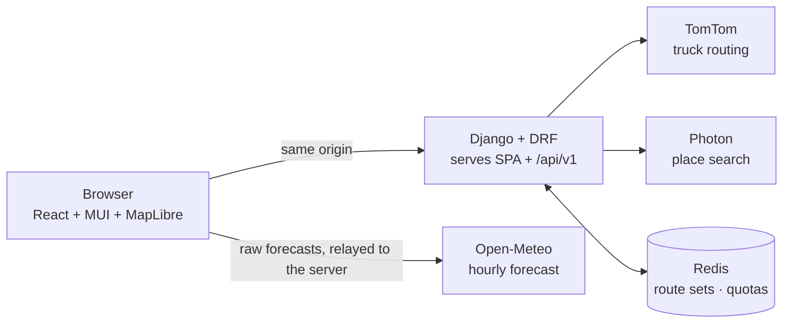

# Truck Weather Routing

A React + Django app that helps a truck driver pick the safest route. It compares three truck routes, checks the weather forecast at each checkpoint for the time the truck will actually be there, scores the risk with the given risk and load rules, and recommends a route. Everything is shown on a map, with a 0–48 hour weather heatmap over the trip corridor.

- **Frontend:** React 19, TypeScript, Material UI 7 (with MUI X Date Pickers), MapLibre GL, TanStack Query, Zustand
- **Backend:** Python 3.12, Django 5, Django REST Framework, Redis cache, shapely, numpy
- **Services:** TomTom Routing API (truck mode), Open-Meteo forecast API, Photon place search, OpenFreeMap basemap

**Live demo:** https://truck-weather-routing-ewdo.onrender.com

> It runs on Render's free plan, which puts the server to sleep after 15 minutes without visitors. If the page is slow to open, the server is waking up. That takes about a minute, and everything is fast after that.

## Run it

### Docker (app + Redis)

```bash
docker compose up --build
```

Open http://localhost:8080. Set `TOMTOM_API_KEY` in your shell or `.env` first to get truck routing (see [Routing providers](#routing-providers)).

### Local development

```bash
cd backend
python -m venv .venv && .venv/Scripts/activate      # macOS/Linux: source .venv/bin/activate
pip install -r requirements-dev.txt
python manage.py runserver 8000
```

```bash
cd frontend
npm install
npm run dev                                          # http://localhost:5173, proxies /api to :8000
```

Copy `.env.example` to `.env` in the repository root to set keys. Without `REDIS_URL` the backend uses an in-memory cache.

### Tests and checks

```bash
cd backend && pytest && ruff check . && ruff format --check .
cd frontend && npm test && npm run lint && npm run typecheck && npm run build
```

CI (`.github/workflows/ci.yml`) runs all of these plus a Docker build on every push.

## How it works



1. **`POST /api/v1/route-sets`** converts the departure (entered as local time at the origin) to UTC, fetches up to three truck routes, and stores them in Redis for an hour. The map draws the routes as soon as this returns.
2. For the assessment, the server places checkpoints, works out each one's ETA, and says which forecasts it needs (**`GET …/assessment/forecast-request`**). The browser fetches those from Open-Meteo and posts them back (**`POST …/assessment`**). The server checks them, reads each checkpoint's weather at its ETA, scores risk and picks the recommendation.
3. The heatmap works the same way, at the same time: the corridor grid comes from the server, the browser fetches forecast hours 0–48, and the server returns the risk for every cell and hour.
4. Switching between 10, 25 and 50 miles only repeats the assessment. The routes are reused, and forecasts already fetched in this session aren't fetched again.

**Why the browser fetches the forecast:** Open-Meteo's free tier is limited per IP address. On shared hosting like Render's free plan, other apps on the same outbound IP use up that daily limit, and the server's weather requests fail. Fetched from the browser, each visitor uses their own quota. The browser only passes the raw data along: the server decides exactly what to fetch, checks units and shape on every response, and does all the risk logic.

### Checkpoints and ETAs

- Checkpoints sit at the origin, every N miles (10, 25 or 50), and the destination. An interval checkpoint within 1 mile of the destination is merged into it.
- ETAs come from the routing engine's own travel-time profile (TomTom `extendedRouteRepresentation=travelTime`), interpolated by distance. If that's missing, they fall back to guidance-instruction times, then to time proportional to distance.
- Each checkpoint represents the road halfway to its neighbours. The "risk miles" are therefore attributed from point samples, and they add up exactly to the route length.

### Weather at the ETA

- Forecasts come from Open-Meteo, pinned to NOAA's GFS/HRRR model (`gfs_seamless`). Units are requested in mph and inches, and the server checks them on every response.
- Rain is `rain + showers`, the total liquid precipitation for the hour. Snow is `snowfall` in inches per hour. Wind is 10 m wind speed.
- Precipitation values are totals for the *preceding* hour, so an ETA of 14:20 reads the 15:00 value, which covers 14:00–15:00. Wind speed is instantaneous, so it's interpolated between 14:00 and 15:00.

### Risk rules

| Condition | Low | Moderate | High | Severe | No Travel |
|---|---|---|---|---|---|
| Wind (mph) | < 25 | 25–<35 | 35–<45 | 45–<55 | ≥ 55 |
| Rain (in/hr) | < 0.10 | 0.10–<0.25 | 0.25–<0.50 | 0.50–1.00 | > 1.00 |
| Snow (in/hr) | < 0.5 | 0.5–<1.0 | 1.0–<2.0 | 2.0–3.0 | > 3.0 |

- **Load rules:** wind ≥ 55 mph is No Travel for any load. 45–54 mph with a load over 30,000 lb is No Travel. 35–44 mph with a load over 40,000 lb is Severe.
- A checkpoint's level is the worst of wind (after the load rules), rain and snow. The popup lists the reason for each factor.
- Missing forecasts are never treated as Low. The checkpoint is marked *No data*, and its route's coverage drops below 100%.

### Recommendation

1. **Eligibility:** a route must have forecasts for every checkpoint and no No Travel miles.
2. Among eligible routes, the brief's order applies: **fewest Severe miles → fewest High miles → lowest risk index → shortest travel time**.
3. The risk index is the distance-weighted average of the levels (Low 0 … No Travel 4). It's an ordinal score for ranking, not a probability.
4. If every route has No Travel miles, the app shows the least risky one with a clear "not safe" warning. If no route has complete forecasts, it doesn't recommend anything.

The UI explains the result in a sentence (for example, "fewest Severe miles: 0 vs 75 on Route B"). The "Why this route?" table shows every criterion for every route, with the deciding row highlighted.

### On the map

- **Routes:** the selected route is coloured stretch by stretch with its risk level. The other routes are grey; click one to select it.
- **Checkpoints:** dots coloured by risk. Zoom in to see each one's ETA next to it, or click one for its ETA, wind, rain, snow and the reason for its level.
- **Route summaries:** a chip at each route's midpoint shows distance, driving time, a dot in the colour of its worst risk level, and a tick on the recommended route.
- **Heatmap:** corridor cells coloured by risk for the forecast hour on the slider (0–48 h from now). Press play to animate it. A truck marker shows where the selected route puts the driver at that hour.

## Interpretation choices

The brief leaves a few details open. These are the choices made, each kept in one place in the code:

| Topic | Choice |
|---|---|
| Overlapping thresholds (e.g. rain 0.25 is in both Moderate and High) | The lower bound is inclusive: 0.25 in/hr is High. Severe includes its upper bound (1.00 / 3.0) because No Travel is strictly greater. |
| 10 / 25 / 50 miles | A user choice, defaulting to 25. |
| Load rules | "Over 30,000 / 40,000 lb" is strictly greater than. They only raise the wind level. |
| Departure time zone | Entered as local time at the origin. The zone is shown in the form, and daylight-saving gaps are rejected. |
| Departure window | From one hour ago to 7 days ahead, so the whole trip stays inside the forecast range. |
| Wind | The brief says "Wind", so the forecast's sustained 10 m wind speed is classified. Gusts run higher and would be the more cautious reading; switching would only change which forecast value is fetched. |
| Forecast slider | Forecast hours 0–48 from now. When the selected hour falls inside the trip, a truck marker shows where the selected route puts the driver. |
| Load vs gross weight | The risk rules use the load as entered. Routing receives gross weight = load + 35,000 lb tare, which the form shows. |

## Performance

- **Rendering:** MapLibre GL draws with WebGL. Every map source and layer is created once. After that, selecting a route only changes filters, and new data only replaces source data.
- **Slider:** each cell stores its risk for every hour (`r0…r48`), so moving the slider only swaps the colour expression (`setPaintProperty`). That happens at most once per animation frame, outside React rendering. Measured in headless Chrome while stepping through all 48 hours: **0 long tasks**, median frame time 8.3 ms.
- **Heatmap colour:** each cell is coloured by its exact risk class. MapLibre's built-in heatmap layer colours by point density, which wouldn't map to a real risk level.
- **Weather fetching:** checkpoints are snapped to a 0.05° grid and de-duplicated across routes, so overlapping routes share forecasts. The browser fetches them in batches of 100 locations, 4 in parallel, and keeps what it has fetched for the session.
- **Measured** (Denver → Chicago, local run): the heatmap covers 272 cells × 49 hours in a 30 KB response.
- **Payload:** route geometry is simplified on the server for display. Distance and time calculations use the full-resolution route.

## API

All endpoints are under `/api/v1`. Errors look like `{"error": {"code", "message", "fields"?}}`.

| Method | Path | Notes |
|---|---|---|
| GET | `/health` | Cache status, routing provider, quota usage |
| GET | `/geocode?q=denver` | `[{label, lat, lon, tz}]`. 90 requests/min per IP |
| POST | `/route-sets` | `{origin, destination, departure_local, load_lb}`. 20 requests/min per IP |
| GET | `/route-sets/{id}/assessment/forecast-request?interval_mi=10\|25\|50` | Open-Meteo URL, parameters and locations to fetch |
| POST | `/route-sets/{id}/assessment` | `{interval_mi, forecasts}` (one Open-Meteo location object or `null` per requested location) → checkpoints, segments, summaries, recommendation |
| GET | `/route-sets/{id}/heatmap/forecast-request` | `{start_utc, forecast}` for the corridor cells |
| POST | `/route-sets/{id}/heatmap` | `{start_utc, forecasts}` → `{start_utc, hours, cell_deg, cells, risk[hour][cell]}`. `null` means no data |

The assessment and heatmap endpoints share a limit of 60 requests/min per IP.

Error codes:

| Status | Code | Meaning |
|---|---|---|
| 400 | `invalid` | Validation failed (per-field messages in `fields`) |
| 404 | `route_set_expired` | The route set is gone; the frontend plans the trip again automatically |
| 429 | `throttled` | Too many requests from this IP |
| 502 | `upstream_error` | A routing, place-search or weather service failed |
| 503 | `quota_exhausted` | Today's budget for a provider is used up |

## Routing providers

With `TOMTOM_API_KEY` set, routes come from TomTom's truck routing:
- It's given the vehicle's weight and commercial status, and the departure time for traffic-aware ETAs.
- It requests up to two alternatives.
- If fewer than three routes come back, it makes one more request that avoids the middle stretch of every route found so far, so the router has to use a different corridor. The extra route is kept only if at least a quarter of it uses different roads, it's no more than 50% slower or longer, and it doesn't double back.
- Any route more than 30% longer than the fastest is labelled **long detour** on its card. It stays in the comparison because the brief asks for three options, but it only wins if it really is the safest.

Without a key, the app falls back to the public OSRM server so it can be run and evaluated without signing up. OSRM is **car** routing and ignores truck restrictions, and the UI says so. All weather and risk logic is identical either way.

## Quotas

Free tiers: TomTom Routing 20,000 requests/month; Open-Meteo 10,000 calls/day per IP for non-commercial use, which each visitor's browser uses for their own forecasts. Redis caches place searches (24 h) and route sets (1 h). Daily counters stop the routing and place-search providers before their limits (settings in `.env.example`). When a budget is used up, the API returns 503 with a clear message, and cached results keep working.

## Deploying (Render)

The Dockerfile builds the frontend and serves it from Django (WhiteNoise), so one service hosts the whole app on one origin. `render.yaml` describes that service.

1. In Render, choose **New → Blueprint** and select this repository.
2. Enter `TOMTOM_API_KEY` when asked. `DJANGO_SECRET_KEY` is generated for you.
3. Render builds the image and redeploys on every push to `main`.

On the free plan the service sleeps after 15 minutes without traffic, and the first request afterwards takes about a minute. Without `REDIS_URL` the app uses an in-memory cache, which is fine for a single instance. To share the cache across restarts, add a Render Key Value instance and set `REDIS_URL`. The same image also runs on Cloud Run or any other container host.

## Project layout

```
backend/
  config/                 Django settings and URLs
  trips/domain/           pure logic: risk, weather timing, sampling, scoring, alternatives, corridor grid
  trips/providers/        TomTom, OSRM, Photon clients; Open-Meteo request and validation; quota budgets
  trips/services.py       orchestration; views stay thin
  tests/                  unit tests for every rule, plus API tests with fake providers
frontend/src/
  api/                    typed client and TanStack Query hooks
  components/             MUI components and the MapLibre map
  lib/                    formatting, geometry and map style expressions (unit tested)
```

## Known limitations

- ETAs assume continuous driving. Mandatory rest breaks (hours-of-service rules) aren't modelled.
- Forecast skill drops with lead time. Departures up to 7 days ahead are allowed, but near-term trips are more reliable.
- Risk miles are attributed from checkpoint samples every N miles. Weather between checkpoints is assumed to match the nearest one.
- Forecasts come through the visitor's browser. The server checks their shape, units and locations, but a visitor could still send made-up weather. That would only change their own result.

## How AI was used

The implementation plan was drafted with Claude Code and reviewed by a second AI assistant. Each review point was checked against the TomTom, Open-Meteo and MapLibre documentation, then accepted, changed or rejected. The full log is in `IMPLEMENTATION_PLAN.md`, Appendix A. The code was written with Claude Code, and every rule is covered by tests.
